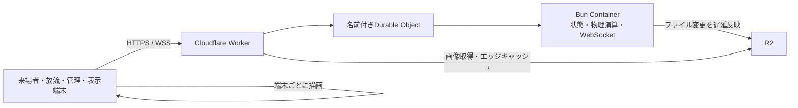
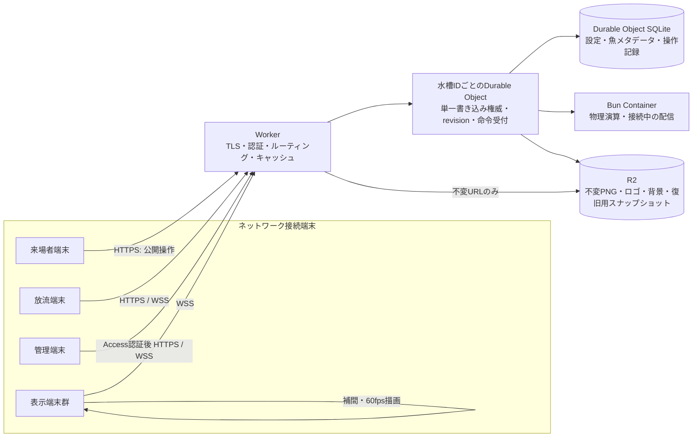

# ネットワーク前提の全体設計

## 方針

この水槽は、同じ会場の来場者端末、放流端末、管理端末、複数の表示端末が、インターネット経由で同じ状態を共有するサービスとして設計する。ブラウザーやContainerのローカルファイルを正本にしない。端末は切断・再接続・再起動しても、サーバーから正しい状態を取り直せる。

当面は1つの水槽に1つのDurable Objectを割り当てる。すべての操作を同じ権威へ送り、書き込みを順序付ける。将来複数のイベントや水槽を運用する場合は、水槽IDごとにDurable Objectを分ける。

## 現行構成と不足

現在は次の経路で動く。

- Workerと同一オリジンの `/api/*` と `/ws` を使っており、URLにlocalhostを埋め込む構成ではない。
- 位置計算と接続管理は1つのBun Containerに集約されている。1つの水槽の位置が複数サーバーで食い違わない点は維持する。
- Containerのローカルファイルは実行中の作業コピーで、`fs.watch` の変更通知を受けてR2へ反映する。R2書き込みはパス単位で直列化されている。既存の`library-index.json`と設定ファイルは、画像・位置checkpointとSQLite初期seedの互換用に残っている。
- Durable Object SQLiteはcommand receipt、単調増加revision、chunk化した完全状態スナップショットを保持する。初回起動時に既存R2状態からseedし、以後のContainer起動ではSQLiteスナップショットを復元する。魚メタデータ・設定・シーンの検索用projectionもあるが、正規化テーブルへの完全移行はまだ完了していない。
- サーバーは約60fpsで全表示端末へ魚位置を送り、端末はPixi.jsで描画する。サーバーが計算を担うのはよいが、高頻度パケットの量と遅延を監視する必要がある。
- WebSocket切断時は指数バックオフとランダムジッターで再接続する。接続・再同期時はrevision付き完全スナップショットを返し、状態イベントの欠落を検出した端末はスナップショットを要求する。過去の差分を再生するログは持たない。
- Cloudflare Access JWTをWorkerで検証し、管理系ページ/APIと表示端末をroleで制限する。来場者向け公開APIは許可リストに限定している。CORSはアクセス制御の代わりにならない。

## 目標構成

### 責務と正本

| 領域 | 正本 | 用途 |
|---|---|---|
| 水槽設定、魚の状態、放流・持ち帰り、ロゴ位置、表示レイヤー | その水槽のDurable Object SQLite | トランザクション、単調増加revision、再起動後の復元 |
| 魚PNG、ロゴ、背景、完成画像 | R2 | バイナリ保存。登録後は内容ハッシュまたは一意IDの不変キーで参照 |
| 魚の現在位置・速度 | 稼働中の水槽シミュレーション。一定間隔の復旧スナップショットをDurable Object SQLiteまたはR2へ保存 | 毎フレームは保存せず、停止時の巻き戻り幅を決めて保存 |
| Containerのディスク | キャッシュ・一時作業領域 | 消えてもR2とDurable Objectの状態から再構成できる |
| ブラウザーのIndexedDB | 未送信の来場者作品と再送用command IDのみ | サーバー確定前の作品を失わないための一時 outbox |

Mutableな `library-index.json` 全体を更新のたびにR2へ書く方式は移行対象とする。R2は大きな画像の保存に向く。細かい状態の競合解決や複数行更新はDurable Object SQLiteで行う。SQLiteに反映される前にクライアントへ「保存済み」と返さない。

SQLiteは概念上、次の単位で保持する。

- `aquarium_config`: world、layers、viewport、モーション設定と現在revision。
- `fish`: fish ID、R2 asset key、PNGメタデータ、アーカイブ・持ち帰り状態、変更revision。
- `commands`: command ID、revision、actor、操作種別、payload、適用状態、応答結果。再送重複排除とContainer復帰時の再生に使う。
- `simulation_checkpoint`: 保存時刻と全魚の位置・速度。頻度を制限して更新する。

画像を差し替える操作は、先に新しい不変R2キーへアップロードし、そのキーをSQLiteのトランザクションで参照する。新しい参照が確定した後に旧キーを回収する。

### 書き込みから描画まで

状態変更はすべてWorkerから水槽のDurable Objectへ送る。ブラウザーからContainerへ直接接続させない。

1. WorkerがCloudflare Accessとロールを検証する。
2. Durable Objectが`commandId`を重複確認し、要求中の状態をSQLiteへ記録する。
3. ContainerがAPI操作を適用し、内部スナップショットAPIで魚・設定・シーン・viewportの状態を返す。画像バイナリは含めない。
4. Durable Objectがスナップショット、revision、command結果をSQLiteの同一トランザクションで確定してから成功応答を返す。本文は最大8MiBの分割スナップショットで、画像バイナリは含めない。
5. 初回はContainerがR2から復元した状態をSQLiteへ一度seedする。以後のContainer起動ではSQLiteの完全スナップショットを復元してから外部リクエストを受け付ける。R2の画像本体はそのまま使い、SQLite snapshotより新しい魚位置checkpointは復元時に重ねる。
6. 接続中の表示端末へrevision付き状態イベントと連番付き位置フレームを配る。イベントの連番が飛んだ端末は差分を続行せず、完全スナップショットを取り直す。

魚の編集、放流、持ち帰り、アーカイブ、設定変更、display viewport変更はcommand APIを使う。WebSocketは接続登録、状態通知、位置フレーム、ポインターやViewportの一時プレビューに使う。旧クライアントからの永続設定WebSocketメッセージは受け付けない。

## 通信契約

1. クライアントは同一オリジンのHTTPS/WSSだけを使う。WorkerがAPI、WebSocket、静的画面、画像配信を振り分ける。
2. 状態を変えるHTTP操作には発行時刻入り `commandId` を必須にする。同じIDは7日間再送でき、期限後のIDは拒否する。WebSocketの永続変更はcommand APIへ移行する。
3. 成功応答には `revision` を含める。Durable Objectは状態変更とrevision更新を1つのSQLiteトランザクションで確定してから応答・配信する。
4. 状態イベントにはrevision、Container世代内の連番を付ける。クライアントがrevisionまたは連番の欠落を見つけたら差分を続けず、全スナップショットを取り直す。
5. 接続直後と`sync_request`の後は常に`state_snapshot`を返す。直近の差分ログを保持しないため、差分再生は行わない。
6. 魚の位置フレームは再生用の一時データで、保存コマンドとは分ける。フレームには世代と`seq`を付ける。遅れた古いフレームは捨てる。
7. WebSocket再接続は指数バックオフとランダムジッターを使う。接続が一定時間安定したら待ち時間を初期化する。再接続後はスナップショットまたは差分で復帰する。
8. 画面描画は各端末で60fpsを維持し、ネットワークからは20〜30fps程度の位置サンプルを受けて補間する。送信側は遅い端末の送信待ちを無限に溜めず、古い位置フレームを破棄する。状態変更イベントは位置フレームと別経路で失わないようにする。

### 端末が切断したとき

- 表示端末は最後の位置を短時間だけ補間し、その後は接続切れを表示する。再接続したらスナップショットから描画を再開する。
- 管理端末は未送信の変更を「未確定」と表示する。再送可能な操作だけを同じcommand IDで再送し、削除・持ち帰りなどを確認なしに再実行しない。
- 来場者の完成画像はサーバーの保存確定応答までIndexedDBに保持する。通信エラーを成功画面に置き換えない。
- 運営端末以外から管理APIを呼べないようにし、公開APIは放流に必要な範囲に絞る。

## 認証と権限

- 管理・表示設定・魚編集はCloudflare Accessで保護する。認証後のWorkerがAccess JWTを検証し、管理APIとWebSocketへロールを渡す。
- 来場者APIは公開するが、画像サイズ、投稿頻度、同一端末の連投を制限する。来場者にR2資格情報や管理API資格情報を持たせない。
- Workerで許可するOriginを明示する。状態変更はロール検証を行う。CORS設定だけで保護した扱いにしない。
- 公開URL、画像ID、魚IDは認証情報として扱わない。

## 配信とキャッシュ

- HTMLは再検証させ、ハッシュ付きJS/CSSと不変画像だけを長期キャッシュする。
- 魚画像・ロゴ・背景はR2からWorker経由で配信し、一意・不変URLだけをエッジキャッシュする。内容を差し替えるときは新しいキーを発行する。
- `/api/*` と `/ws` は `no-store`。状態の応答を共有キャッシュへ入れない。
- 表示端末が同じ画像を繰り返し要求しないよう、画像キーと読み込み結果を端末内でもキャッシュする。

## 今回の実装範囲と残作業

### 実装済み

- Workerは`/manage`、`/controller`を`manage`または`admin`、`/display`を`display`または`admin`で保護する。これら以外の`/api/*`は`manage`または`admin`を要求する。
- 公開APIは`POST /api/scan`、`POST /api/release`、`GET /api/state`に限定する。来場者向け状態応答は`activeFish`だけで、状態APIと画像以外の動的応答は共有キャッシュしない。
- 公開APIはCloudflareの送信元IPをSHA-256化して、scan 30回/10分、release 60回/10分、state 240回/分に制限する。scan本文は12 MiB、release本文は64 KiBまでとし、超過は413、レート超過は`Retry-After`付き429を返す。生IPはContainerへ転送・保存しない。
- WorkerはAccess JWTの署名・issuer・audience・有効期限を検証し、確認したidentityだけを内部ヘッダーでContainerへ渡す。UUID prefixによる管理・表示権限付与は廃止した。
- 変更要求には発行時刻入りcommand IDが必須で、同一IDの再送はSQLiteの受付記録で重複実行を防ぎ、別actorまたは異なる要求内容との衝突を拒否する。command IDの期限は7日で、期限後の再送は拒否する。小さいJSON応答は7日間再送でき、receiptも7日で削除する。SQLiteには最大50,000件を保持し、上限中の新しい変更には`503 command_capacity_reached`を返す。不明なcommandは成功扱いにせず、2分以上pendingのまま再送された場合は`result_unavailable`を返す。
- Containerの初回seedはR2から読み込んだ完全状態で行い、次回以降は確定済みSQLiteスナップショットを復元する。snapshotには魚位置・設定・シーン・viewportを含め、画像参照URLだけを保存する。`data:`/`blob:`参照は受け付けない。R2位置checkpointがsnapshotより新しければ位置と速度を適用する。別のpending commandまたは不明なcommandがある場合は古い状態を自動適用しない。再起動時にはブラウザー編集セッションの一時ロックを解除する。
- ブラウザーAPIは同一オリジンに限定し、変更要求へcommand IDを付ける。管理画面の水槽設定と表示端末のviewport保存はHTTP command経路を使う。WebSocketは指数バックオフとジッター、完全snapshot再同期を使う。

### 運用前に設定するもの

- Cloudflare Worker variablesに`CF_ACCESS_TEAM_DOMAIN`と`CF_ACCESS_AUD`を設定する。role claimが`roles`以外の場合は`CF_ACCESS_ROLES_CLAIM`にもclaim pathを設定する。値はリポジトリへ書き込まない。
- Cloudflare Access側で`manage`、`display`、`admin`を含むJWT claimを発行する。Access policyでは管理端末、放流端末、表示端末に必要なroleを割り当てる。
- `AQUARIUM_ALLOW_UNTRUSTED_ACCESS=true`はローカル開発時だけ設定する。このバイパスはリクエストhostがloopbackの場合に限り有効。
- `AQUARIUM_ORIGIN`を使う開発構成では、`AQUARIUM_ORIGIN_MODE=local`も明示する。productionではDurable ObjectのContainer bindingを使う。
- command IDの形式が変わるため、Workerと静的画面を一緒に公開した後、以前から開いたままの端末画面は再読み込みする。

### まだ設計どおりではない部分

- SQLiteは完全状態のchunked JSON snapshotとcommand receiptを正本として保持し、魚メタデータ・設定・scene projectionsも持つ。R2索引・設定ファイルからSQLiteへの初回seedとprojectionは実装済みだが、正規化テーブルへの段階移行や実データとの運用照合は残る。
- 状態snapshotは成功したHTTP変更後に保存する。稼働中の魚位置はR2へ約15秒ごとにcheckpointされるため、Container停止時は最後のR2位置保存以降の移動が巻き戻る可能性がある。起動時はSQLiteの完全snapshotを復元し、snapshotより新しいR2位置checkpointをマージする。
- 旧WebSocket永続変更イベントは拒否し、対象UIはHTTP commandへ移行済み。状態イベントの履歴保存と差分再生は未実装で、欠落時は最大8MiBの完全snapshotを再送する。
- 不明なcommandは二重実行せずSQLite状態を不確実扱いにし、ContainerのR2 fallbackを自動で正本にしない。運営側で実際の状態を照合して復旧する手順は残る。
- R2 seed、スナップショット復元、Access policy、複数端末の同時操作、回線断・Container再起動・R2障害を含む本番受け入れ確認と監視設定は運用前に行う。

## 移行手順

### 1. データ保全とR2書き込みの順序保証

- 現在のR2オブジェクトと索引を読み取り専用で退避・照合する。APIから消えた9件はキャッシュ応答をR2原本の証拠にせず、オブジェクトとメタデータを直接確認してから復元する。
- 同一R2キーへの書き込みをContainer内で直列化する。変更世代を記録し、書き込み中に新しい変更があれば後続の最新内容を書き込む。
- 終了時のflush失敗を成功終了として扱わない。保存失敗を観測可能にする。

### 2. Durable Object SQLiteへ状態を移す

- R2の索引と設定を一度読み、SQLiteへ投入する。件数、魚ID、画像参照、アーカイブ状態、設定revisionを照合してから切り替える。
- しばらくは読み取り比較を行うが、同じ状態を別々の仕組みで長期二重書き込みしない。
- 切替後、Containerのローカルファイルはキャッシュに限定し、起動時はSQLiteの状態をロードする。R2へは不変バイナリと定期スナップショットだけを書く。

### 3. コマンドと再接続の契約を入れる

- `commandId`、`revision`、ack、重複排除、全状態再取得をHTTPとWebSocketへ導入する。
- 放流、魚編集、ロゴ変更、持ち帰り、アーカイブ、シーン編集を同じルールに揃える。
- ネットワーク切断中の未確定・再送中・保存済みを各画面で区別する。

### 4. 権限境界とネットワーク運用

- カスタムドメインとCloudflare Accessを設定し、管理系を保護する。
- 観測項目に水槽revision、最後の永続化時刻、R2書き込み待ち数・失敗数、WebSocket接続数・最終フレーム時刻を加える。
- 実際の複数端末・回線断・Container再起動・R2失敗・重複要求を使って受け入れ確認する。

## 受け入れ条件

- Container再起動後、全魚・設定・アーカイブ状態が同じrevisionで戻る。
- 複数端末から同時に編集しても、成功応答に含まれるrevision順に全端末が同じ状態へ収束する。
- 回線断と再接続で、状態変更が二重適用・無言破棄されない。
- R2の保存失敗時に成功表示を返さず、復旧後に再送・再試行できる。
- 画像の差し替え後も古いキャッシュ内容が新しい画像として表示されない。
- 管理操作はAccess認証のない外部リクエストから実行できない。

## 参考

- [Cloudflare Containersのライフサイクルと一時ディスク](https://developers.cloudflare.com/containers/concepts/architecture/)
- [SQLite-backed Durable Object Storage](https://developers.cloudflare.com/durable-objects/api/sqlite-storage-api/)
- [Durable ObjectsのWebSocketとHibernation](https://developers.cloudflare.com/durable-objects/best-practices/websockets/)
- [Durable Objectsの制限](https://developers.cloudflare.com/durable-objects/platform/limits/)
