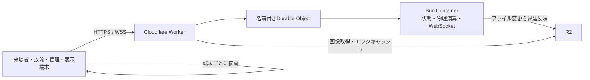
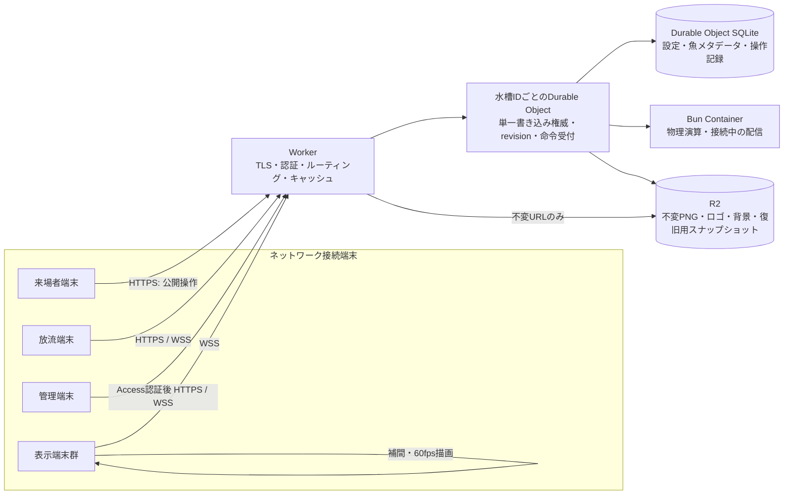

# ネットワーク前提の全体設計

## 方針

この水槽は、同じ会場の来場者端末、放流端末、管理端末、複数の表示端末が、インターネット経由で同じ状態を共有するサービスとして設計する。ブラウザーやContainerのローカルファイルを正本にしない。端末は切断・再接続・再起動しても、サーバーから正しい状態を取り直せる。

当面は1つの水槽に1つのDurable Objectを割り当てる。すべての操作を同じ権威へ送り、書き込みを順序付ける。将来複数のイベントや水槽を運用する場合は、水槽IDごとにDurable Objectを分ける。

## 現行構成と不足

現在は次の経路で動く。

- Workerと同一オリジンの `/api/*` と `/ws` を使っており、URLにlocalhostを埋め込む構成ではない。
- 位置計算と接続管理は1つのBun Containerに集約されている。1つの水槽の位置が複数サーバーで食い違わない点は維持する。
- Containerのローカルファイルが実行中の作業コピーで、`fs.watch` の変更通知を500ms後にR2へ書き戻す。R2側の索引 `library-index.json` は全魚のメタデータを書き換えるため、保存が重なると古い書き込みが後から反映される余地がある。Container停止直前の遅延書き込みにも依存している。
- Durable ObjectにSQLiteストレージは割り当て済みだが、魚や設定の正本としては使っていない。
- サーバーは約60fpsで全表示端末へ魚位置を送り、端末はPixi.jsで描画する。サーバーが計算を担うのはよいが、高頻度パケットの量と遅延を監視する必要がある。
- WebSocket切断時に再接続はするが、固定3秒間隔だった。切断が続く端末が同時に再試行する同期集中を避けられない。
- 管理系APIの認証・権限境界とCORSはネットワーク公開を前提に見直す必要がある。CORSはアクセス制御の代わりにならない。

## 目標構成

### 責務と正本

| 領域 | 正本 | 用途 |
|---|---|---|
| 水槽設定、魚の状態、放流・持ち帰り、ロゴ位置、表示レイヤー | その水槽のDurable Object SQLite | トランザクション、単調増加revision、再起動後の復元 |
| 魚PNG、ロゴ、背景、完成画像 | R2 | バイナリ保存。登録後は内容ハッシュまたは一意IDの不変キーで参照 |
| 魚の現在位置・速度 | 稼働中の水槽シミュレーション。一定間隔の復旧スナップショットをDurable Object SQLiteまたはR2へ保存 | 毎フレームは保存せず、停止時の巻き戻り幅を決めて保存 |
| Containerのディスク | キャッシュ・一時作業領域 | 消えてもR2とDurable Objectの状態から再構成できる |
| ブラウザーのIndexedDB | 未送信の来場者作品と再送用command IDのみ | サーバー確定前の作品を失わないための一時 outbox |

Mutableな `library-index.json` 全体を更新のたびにR2へ書く方式は移行対象とする。R2は大きな画像の保存に向く。細かい状態の競合解決や複数行更新はDurable Object SQLiteで行う。SQLiteに反映される前にクライアントへ「保存済み」と返さない。

SQLiteは概念上、次の単位で保持する。

- `aquarium_config`: world、layers、viewport、モーション設定と現在revision。
- `fish`: fish ID、R2 asset key、PNGメタデータ、アーカイブ・持ち帰り状態、変更revision。
- `commands`: command ID、revision、actor、操作種別、payload、適用状態、応答結果。再送重複排除とContainer復帰時の再生に使う。
- `simulation_checkpoint`: 保存時刻と全魚の位置・速度。頻度を制限して更新する。

画像を差し替える操作は、先に新しい不変R2キーへアップロードし、そのキーをSQLiteのトランザクションで参照する。新しい参照が確定した後に旧キーを回収する。

### 書き込みから描画まで

状態変更はすべてWorkerから水槽のDurable Objectへ送る。ブラウザーからContainerへ直接接続させない。

1. WorkerがCloudflare Accessとロールを検証する。
2. Durable Objectが`commandId`を重複確認し、状態変更とrevision、command結果をSQLiteの同一トランザクションで確定する。
3. 確定したcommandを内部APIでContainerへ渡す。Containerは物理演算と表示用フレーム生成を担当し、魚・設定の永続的な正本を持たない。
4. Container停止中ならcommandはSQLiteに保留し、復帰後にrevision順で再送する。応答は適用完了と保留中を区別する。
5. 接続中の表示端末へ状態イベントと位置フレームを配る。再接続時の完全な状態はDurable Objectから取得するため、配信中Containerのメモリだけに復帰を依存させない。
6. Containerは一定間隔の位置・速度スナップショットをDurable Objectへ報告する。毎フレームや画像本体はSQLiteへ保存しない。

魚の編集、放流、持ち帰り、アーカイブ、設定変更はcommand APIを使う。WebSocketは接続登録、状態通知、位置フレーム、ポインターやViewportの一時プレビューに使う。現在WebSocket経由で送っている永続設定変更は、移行時にcommand APIへ移す。

## 通信契約

1. クライアントは同一オリジンのHTTPS/WSSだけを使う。WorkerがAPI、WebSocket、静的画面、画像配信を振り分ける。
2. 状態を変えるHTTP/WS操作には `commandId` を付ける。同じIDの再送は二重作成せず、最初の結果を返す。
3. 成功応答には `revision` を含める。Durable Objectは状態変更とrevision更新を1つのSQLiteトランザクションで確定してから応答・配信する。
4. 状態イベントにもrevisionを含める。クライアントが飛び番を見つけたら差分を適用せず、全スナップショットを取り直す。
5. 接続直後は `hello`、認証済みロール、最後に適用したrevisionを送る。サーバーは差分が残っていれば差分、なければ `state_snapshot` を返す。
6. 魚の位置フレームは再生用の一時データで、保存コマンドとは分ける。フレームには `seq` と `serverTime` を付ける。遅れた古いフレームは捨てる。
7. WebSocket再接続は指数バックオフとランダムジッターを使う。接続が一定時間安定したら待ち時間を初期化する。再接続後はスナップショットまたは差分で復帰する。
8. 画面描画は各端末で60fpsを維持し、ネットワークからは20〜30fps程度の位置サンプルを受けて補間する。送信側は遅い端末の送信待ちを無限に溜めず、古い位置フレームを破棄する。状態変更イベントは位置フレームと別経路で失わないようにする。

### 端末が切断したとき

- 表示端末は最後の位置を短時間だけ補間し、その後は接続切れを表示する。再接続したらスナップショットから描画を再開する。
- 管理端末は未送信の変更を「未確定」と表示する。再送可能な操作だけを同じcommand IDで再送し、削除・持ち帰りなどを確認なしに再実行しない。
- 来場者の完成画像はサーバーの保存確定応答までIndexedDBに保持する。通信エラーを成功画面に置き換えない。
- 運営端末以外から管理APIを呼べないようにし、公開APIは放流に必要な範囲に絞る。

## 認証と権限

- 管理・表示設定・魚編集はCloudflare Accessで保護する。認証後のWorkerがAccess JWTを検証し、管理APIとWebSocketへロールを渡す。
- 来場者APIは公開するが、画像サイズ、投稿頻度、同一端末の連投を制限する。来場者にR2資格情報や管理API資格情報を持たせない。
- Workerで許可するOriginを明示する。状態変更はロール検証を行う。CORS設定だけで保護した扱いにしない。
- 公開URL、画像ID、魚IDは認証情報として扱わない。

## 配信とキャッシュ

- HTMLは再検証させ、ハッシュ付きJS/CSSと不変画像だけを長期キャッシュする。
- 魚画像・ロゴ・背景はR2からWorker経由で配信し、一意・不変URLだけをエッジキャッシュする。内容を差し替えるときは新しいキーを発行する。
- `/api/*` と `/ws` は `no-store`。状態の応答を共有キャッシュへ入れない。
- 表示端末が同じ画像を繰り返し要求しないよう、画像キーと読み込み結果を端末内でもキャッシュする。

## 移行手順

### 1. データ保全とR2書き込みの順序保証

- 現在のR2オブジェクトと索引を読み取り専用で退避・照合する。APIから消えた9件はキャッシュ応答をR2原本の証拠にせず、オブジェクトとメタデータを直接確認してから復元する。
- 同一R2キーへの書き込みをContainer内で直列化する。変更世代を記録し、書き込み中に新しい変更があれば後続の最新内容を書き込む。
- 終了時のflush失敗を成功終了として扱わない。保存失敗を観測可能にする。

### 2. Durable Object SQLiteへ状態を移す

- R2の索引と設定を一度読み、SQLiteへ投入する。件数、魚ID、画像参照、アーカイブ状態、設定revisionを照合してから切り替える。
- しばらくは読み取り比較を行うが、同じ状態を別々の仕組みで長期二重書き込みしない。
- 切替後、Containerのローカルファイルはキャッシュに限定し、起動時はSQLiteの状態をロードする。R2へは不変バイナリと定期スナップショットだけを書く。

### 3. コマンドと再接続の契約を入れる

- `commandId`、`revision`、ack、重複排除、全状態再取得をHTTPとWebSocketへ導入する。
- 放流、魚編集、ロゴ変更、持ち帰り、アーカイブ、シーン編集を同じルールに揃える。
- ネットワーク切断中の未確定・再送中・保存済みを各画面で区別する。

### 4. 権限境界とネットワーク運用

- カスタムドメインとCloudflare Accessを設定し、管理系を保護する。
- 観測項目に水槽revision、最後の永続化時刻、R2書き込み待ち数・失敗数、WebSocket接続数・最終フレーム時刻を加える。
- 実際の複数端末・回線断・Container再起動・R2失敗・重複要求を使って受け入れ確認する。

## 受け入れ条件

- Container再起動後、全魚・設定・アーカイブ状態が同じrevisionで戻る。
- 複数端末から同時に編集しても、成功応答に含まれるrevision順に全端末が同じ状態へ収束する。
- 回線断と再接続で、状態変更が二重適用・無言破棄されない。
- R2の保存失敗時に成功表示を返さず、復旧後に再送・再試行できる。
- 画像の差し替え後も古いキャッシュ内容が新しい画像として表示されない。
- 管理操作はAccess認証のない外部リクエストから実行できない。

## 参考

- [Cloudflare Containersのライフサイクルと一時ディスク](https://developers.cloudflare.com/containers/concepts/architecture/)
- [SQLite-backed Durable Object Storage](https://developers.cloudflare.com/durable-objects/api/sqlite-storage-api/)
- [Durable ObjectsのWebSocketとHibernation](https://developers.cloudflare.com/durable-objects/best-practices/websockets/)
- [Durable Objectsの制限](https://developers.cloudflare.com/durable-objects/platform/limits/)
